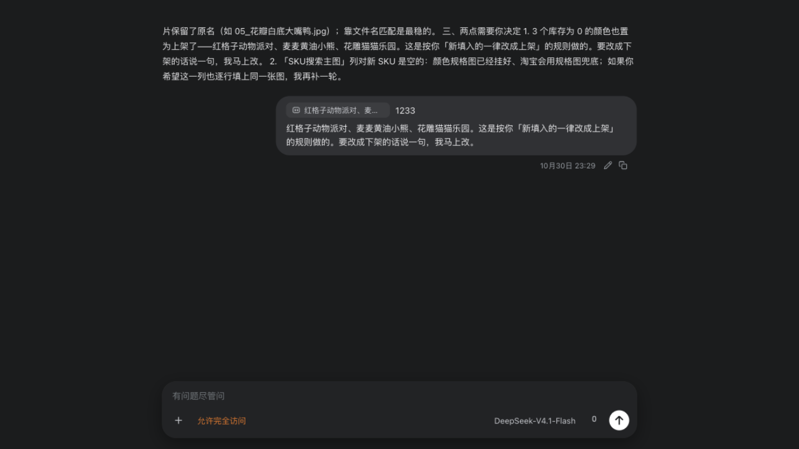
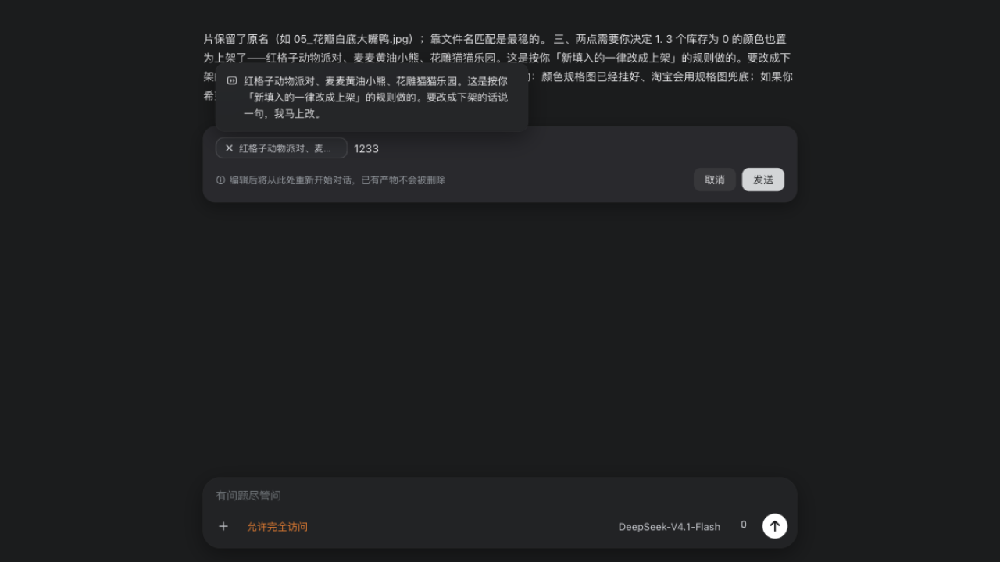

# dsh-plugin-select-quote-with-edit

[DeepSeek Harness](https://deepseek-harness.github.io/deepseek-harness/guide/quickstart)（dsh）的客户端插件，把「划词引用」「消息编辑」「消息撤回」合成一个插件：

- **划词引用**：选中对话文字，浮出「复制 / 添加到对话」；引用以**行内胶囊**落在输入框光标处（跟着文字走）并回显在已发送气泡，悬停查看全文，删除键即删
- **点击定位原文**：点输入框里的引用 chip，自动滚回原文那一行并给它划上下划线（再点一次取消）
- **超长文本胶囊**：把复制的超长文本（≥500 字符）直接粘贴进输入框，自动折叠为一枚胶囊 chip（文档图标 + 截断文本），落在光标处、不撑爆输入框；发送后消息里同样是胶囊，**点击胶囊在右侧边栏打开详情**滚动查看全文
- **消息编辑**：悬停自己发送的消息，在气泡下方的悬停操作行里出现「编辑」；内联编辑后作为一条新消息发出
- **消息撤回**：编辑按钮后面再加一个「撤回」↶ 图标，一键回退该消息及其之后的内容、还原本轮改过的文件，并把原文（含引用 chip）填回输入框
- **输入框手动调高**：拖动输入框卡片顶边中央的 grip 上下调整高度（上拖变高，上限 min(60vh, 640px)），双击复原；高度持久化，刷新后保留



## 功能

### 划词引用

- **复制随引用**：点消息操作行的「复制」复制正文；若消息带引用，引用数据随剪贴板 HTML 通道一并携带（不可见，粘贴到其他应用只看到正文）；**粘贴回输入框时自动还原成待发引用 chip + 正文**，效果与「添加到对话」一致
- **划词工具条**：选区上方浮出「复制 / 添加到对话」（没空间自动翻到下方）；「复制」点击后变「已复制」，1.5 秒还原，不打断选区
- **行内胶囊**：引用以 chip（图标 + 截断文本）**插在输入框光标所在的文字中间**，和正文一起排版流动——不再是钉在输入框左上角的一行；方向键一步跨过、换行/退格都按一个整体字符处理
- **删除键即删引用**：光标挨着胶囊按 `Backspace` / `Delete`，胶囊整块消失，对应的待发引用同时从 store 里移除，发送按钮随之置灰（胶囊与引用不会各说各话）；删错了就重新划词添加一次
- **落点规则**：光标在正文里 → 插在光标处并把光标挪到胶囊后面继续打字；光标在空行 → 跟在已有胶囊后面，**接着打的字还是同一行**（不会把胶囊单独挤成一行）；焦点在对话区（刚划完词）→ 落到最后一行的行尾；粘贴生成的超长文本胶囊同样落在光标处
- **顺序和你输入的一致**：`引用 + 文本1111 + 长文本 + 文本222` 这样交错着输入，发出去的气泡里胶囊就夹在对应的文字中间（不是把两枚胶囊都堆到最前面）；点「撤回」回填到输入框时也是同样的顺序
- **整段复制能带走胶囊**：在输入框里全选复制，剪贴板里每枚胶囊是它的文字（粘到别处读得懂），粘回输入框则胶囊、文字、顺序一并还原；全选后按 `Backspace` / `Delete`（或 `⌘X` 剪切、直接打字覆盖）**一次就把胶囊和文字全清掉**，引用同时从 store 移除
- **悬停交互不变**：悬停时 × **替换掉胶囊最前面的引用图标**（胶囊宽度不变、不是另挂一个删除按钮），移出即还原图标，悬停同时浮出全文预览，点胶囊本体仍是「定位原文 / 打开详情」
- **保底回退**：宿主版本里没有行内引用节点（或插入被编辑器拒绝）时，自动退回原来的「输入框顶部 chip 行」，功能不受影响
- **发送仍靠折叠**：只有引用没打字时发送按钮依然可用（U+200B 标记）；发送瞬间把胶囊折叠成协议块，胶囊占位符（U+FFFC）在 compose 前被剥掉，不会漏进消息
- **发送回显**：引用以协议块随消息交给模型；发送瞬间回显与排队预览里的协议 JSON 自动剥离
- **气泡回显**：已发送消息渲染为「引用 chip + 正文」——顶部胶囊已表达引用，**下方不再重复铺开引用全文**；悬停 chip 查看全文
- **随会话持久化**：未发送引用存 localStorage（保留 20 个会话 / 7 天），刷新恢复，跨标签对账；撤回消息带协议块回输入框时自动拆回待发 chip

### 点击定位原文

- **滚回原文**：点输入框里的引用 chip，在对话里找回这段文字，把那一行**滚到视口中间**；再点同一枚 chip 取消标记，`Esc` 或点击别处也会取消
- **原文划下划线**：找到的位置直接**给原文加下划线**（淡蓝底 + 底部 2px 虚线，像「引用标记」而不是超链接），多行引用逐行划线；下划线是叠在消息上的一层 fixed 指示，**不改写消息 DOM**；**每行只画一条**——同一行里的行内 `code` / 加粗会各自报一个 rect，插件先把它们按视觉行合并再画，避免叠出两道线（否则 React 下次 diff 会撞到被包过的文本节点）
- **匹配是「拍平后」的**：渲染后的 markdown 会把一句话拆成多个文本节点（`但 ` + `<code>node_modules</code>` + ` 里…`），插件把整段拍平成一行再匹配，命中区间反查回 `(node, offset)`；跨段落、跨行内强调、代码块都能命中，空白/换行差异自动归一
- **同句多处取最近的**：同一段文字出现多次时取**最后出现**的那一处（离输入框最近，几乎总是刚选的那处）；超长引用按前缀逐级回退匹配
- **找不到会说**：原文不在已加载的消息里（更早、被撤回、或已被删除）时，底部浮出提示「没找到原文…」，不会静默失败
- **超长文本胶囊不同**：粘贴生成的长文本胶囊没有对话里的原文，点它打开右侧详情（见下节）

### 超长文本胶囊

- **粘贴即折叠**：向输入框粘贴 ≥ 500 字符（`LONG_TEXT_THRESHOLD`）的纯文本时，粘贴被拦截，文本不进入编辑器，而是变成一枚**长文本胶囊**（三行文字线的文档图标 + 截断文本 + 悬停 × 删除），与引用 chip 同一套交互；短文本、图片、带引用数据的粘贴不受影响。拦截在 document 捕获阶段用 `stopImmediatePropagation` 截断事件——宿主 Lexical 编辑器的 paste 处理不检查 `defaultPrevented`，事件若冒泡到编辑器根元素会把全文再插一遍
- **悬浮预览可滚动**：悬停胶囊浮出全文预览面板，超长内容在面板内**滚动查看**（最大高度 50vh），不会铺满屏幕
- **发送后仍是胶囊**：全文经 `<dsh-quotes>` 协议块（条目带 `long: true`）随消息交给模型；气泡里渲染为长文本胶囊，**点击即在右侧边栏打开详情**——优先打开宿主**原生右侧边栏**标签页（`sidebarRight` / `sidebarRightTabs` 经插件 `inject` 声明注入 + `sidebar.right.pane.tab` slot + `sidebarRight.openTabIn` 按会话打开，与 `dsh-file-review` 同款接入），降级为本地滑出抽屉
- **详情页照 `dsh-file-review` 的审查面板排版**：标签页由宿主画（`×` 关闭、分屏/放大都是宿主的），面板内部是——顶部一条 64px 标题条（图标块 + 标题 + `19 行` / `792 字符` 两枚胶囊标签，右侧圆角工具条里放「复制全文」「自动换行」），下面是浅灰画布上的一张圆角卡片，卡片头一行（折叠箭头 + 图标 + 名称 + 行数/字数），正文是**行号 gutter + 等宽代码**（横向滚动时行号固定在左侧、逐行悬停高亮）；折叠箭头可收起正文
- **JSON 自动识别**：胶囊内容是 JSON 时（自动嗅探 + 紧凑 JSON 自动格式化），代码区按**语法配色**展示（键 / 字符串 / 数字 / 字面量各有配色，明暗主题适配），默认不换行、可一键切「自动换行」；非 JSON 走同一套行号视图但不带配色，且默认自动换行
- **撤回原样还原**：带长文本胶囊的消息撤回后，协议块回填输入框时自动拆回胶囊 chip（长文本标记随 store 持久化保留），直接重发即可

### 消息编辑

- **悬停操作行**：普通消息把「编辑 + 撤回」作为**独立按钮常驻**在宿主操作行里，紧跟在原生「时间 + 复制」之后——与复制按钮**同步显隐**（同处宿主的 `[data-clock]` 容器，跟着它自己的悬停显隐过渡一起出现/淡出），不再单独增删、也不会只用一次就消失；带引用的气泡无宿主行，由插件自绘同款操作行（尺寸/间距与宿主一致）；引用气泡行**恒定预留操作行高度**，展示/隐藏不再引起消息上下跳动
- **内联编辑**：原气泡变成编辑卡——引用 chip **按它原本在正文里的位置**嵌在文字中间（与发送后气泡同一套 `at` 偏移），下方提示与「取消 / 发送」；卡片随内容收缩、与气泡同侧右对齐（`max-width: 76%`），不再横跨整行；`Esc` 取消、`⌘/Ctrl + Enter` 发送；空正文且无引用时发送置灰
- **编辑时管理引用**：悬停 chip，× **替换引用图标占位**（胶囊宽度不变），上方浮出全文预览；点 × 从本次编辑移除该引用，发送按剩余引用重组协议块
- **顺序不丢**：发送时从编辑器 DOM 读回「每枚 chip 停在正文第几个字符」，漂移/删改后的位置照样写进 `at`——编辑再发送，气泡里的胶囊位置与编辑卡所见一致
- **发送为新消息**：写回输入框并触发宿主自己的发送手势（带折叠守卫，不与撤回还原竞态）；引用原样保留



### 消息撤回

- **编辑按钮后的 ↶ 图标**：普通消息把「撤回」注入宿主悬停操作行，紧跟在「编辑」之后（时间 + 复制 + 编辑 + 撤回）；带引用的气泡在插件自绘操作行里同样排在「编辑」之后。两种消息的操作行尺寸/间距与宿主原生行完全一致
- **一条消息的三种撤回**：点一下，目标消息及其之后的内容从模型上下文与渲染对话中撤回；本轮被工具改过的文件按检查点还原；被撤回消息的原文**点击即回填**输入框（不等待文件还原跑完），改完可直接重发
- **引用胶囊原样保留**：带引用的消息撤回后，协议块回填输入框时会被自动拆回**待发引用 chip**——和撤回前一样显示为引用胶囊，正文也回到编辑器
- **图片一并恢复**：带图片的消息撤回后，除了文字，消息里的图片也会按附件重新读回并加回输入框（与宿主附件一致的预览），不会只剩文字
- **深撤回不留白**：撤回后自动把历史窗口回退到目标消息（`session.loadThrough`），避免多次/较早撤回后打开会话只见「加载更早」的空白页
- **内置回退引擎**：撤回的「对话回退 + 文件还原」由随本插件自动安装并挂载的 [`dsh-rewind-plugin`](https://github.com/SiriLee/dsh-rewind) 提供（内部 `/rewind-plugin @<seq> both` 命令）；其自带的 ↶ 按钮会被隐藏，只保留本插件这一个「撤回」入口

### 输入框手动调高

- **顶边 grip 拖拽**：输入框卡片顶边中央有一枚横向 grip（悬停变亮），按住上下拖动即可调整编辑器高度——**向上拖变高**（输入框贴窗口底边），向下拖变矮；拖动时正文自动滚动，不影响已有 chip 与草稿
- **最大高度限制**：高度钳制在 44px ～ min(60vh, 640px)，小窗口也不会把对话区挤没；高度写入编辑器滚动区的 inline style，不影响宿主默认布局
- **双击复原 + 持久化**：双击 grip 恢复宿主默认高度并清除记忆；拖出的高度存 localStorage，刷新、切换会话后仍然保留

## 安装

**从 Git 仓库直装**（桌面端插件页填入仓库地址，或命令行）：

```sh
dsh plugin --profile desktop add git+https://github.com/xiangdongbu/dsh-plugin-select-quote-with-edit.git
# 或 SSH：
dsh plugin --profile desktop add git+ssh://git@github.com/xiangdongbu/dsh-plugin-select-quote-with-edit.git
```

仓库已提交构建产物（`lib/index.js`、`lib/client.js`），克隆即可安装，无需本地构建。装完若界面没立刻出现，重启一次 App；之后改 `lib/client.js` 由 `dsh-client-hmr` 热替换。

> 「撤回」的引擎 `dsh-rewind-plugin` 是本包依赖，安装本插件时会一并安装，并由本包 `cordis.patch.yml` 挂载；升级到含撤回的版本后**需要重启一次**以加载它的 Host 半部（文件快照/回退命令）。

> 这是 `dsh-plugin-select-quote-simple` 与 `dsh-plugin-edit` 的合并版：**安装本插件后请卸载那两个旧插件**，避免重复的划词工具条与消息接管。

本地开发：

```bash
git clone git@github.com:xiangdongbu/dsh-plugin-select-quote-with-edit.git
cd dsh-plugin-select-quote-with-edit
npm install && npm run check
cp dev.patch.example.yml dev.patch.yml   # 把 <CHECKOUT> 改成本仓库的绝对路径
dsh web --patch "$PWD/dev.patch.yml"
```

已装进桌面 profile 时，`npm run sync:desktop` 可热更新（`lib/` 推过去触发重载，
同时把 `package.json` / `locale` / `README` 等包文件一并对齐，免得副本还停在旧版本号）。

## 本地验证

```bash
npm run check        # typecheck + build + 114 项无头校验
npm run mock         # mock 宿主 + http://127.0.0.1:4173/test/mock/app.html
```

mock 宿主复刻 dsh web 客户端 DOM 约定（composer 卡片、lexical 编辑器、flow-key 消息行、宿主悬停操作行、发送回显、slot 注册表），并内置 priority -10 的模拟消息插件视图（`?fakequote=1`）验证委托共存；`sessions` / `uiConversation` 服务则模拟回退引擎执行 `/rewind-plugin @<seq> both`。已验证：划词工具条、复制（已复制反馈）、添加到对话（单条不重复）、行内胶囊（光标处插入 / 行首插入 / 空行追加 / 无光标落末行 / Backspace·Delete 删掉胶囊且引用同步移除 / 宿主无该节点类型时回退顶部行）、输入框 chip 悬停时 × 替换图标、发送折叠与回显剥离（含 U+FFFC 占位符剥离）、气泡 chip 回显且不再重复引用全文、悬停操作行（普通消息编辑 + 撤回按钮注入宿主行 + 引用气泡插件行、恒定预留高度不跳动）、内联编辑、编辑卡 × 替换图标（宽度不变）、移除引用后发送、保留引用发送、撤回（移除消息 + 定位 seq + `both` 模式还原文件 + 原文回填 + 引用胶囊还原）、无引用插件环境独立运行。

## 消息协议

```
# Quoted references:
Each item in the block below is text the user selected ...

<dsh-quotes>
[{"text":"…","at":0},{"text":"粘贴的超长文本…","long":true,"at":12}]
</dsh-quotes>

用户正文
```

与 `dsh-plugin-select-quote-simple` / `dsh-plugin-edit` 完全同格：JSON 内 `<` 转义 `\u003c`；展示层只认完整标记对（JSON 坏也剥）；只有完整 + JSON 合法 + 非空数组的块才会还原成待发 chip。`long: true` 标记长文本胶囊（本插件 0.3.0+），`at` 是这枚胶囊在你输入正文里的字符位置（0 = 正文最前面，省略则退回「胶囊都排在最前」的老排版），旧消息无这两个字段照样能读。

## 实现要点（详见 [docs/internals.md](docs/internals.md)）

- 一个浏览器模块承载三套功能，`user` / `steering` 消息节点以 `priority: -20` 接管：挂 `display: contents` 标记（供悬停 chrome 定位与原文注册）、引用消息自绘 chip 气泡、普通消息委托宿主视图
- 划词工具条、输入框（行内胶囊走宿主 Lexical 的 `reference-chip` 节点，顶部 chip 行仅兜底）、悬停操作行、内联编辑器分别挂 `shell.overlay` 与 `conversation.input.overlay`；编辑器经 bridge 拿到宿主 `inputActions`，发送前先置折叠守卫再写草稿，避免撤回还原竞态
- 消息撤回经 bridge 拿到宿主 `sessions` / `uiConversation`：从 chat 快照按 anchor key 解析消息 `seq`，调用回退引擎的 `/rewind-plugin @<seq> both`（对话回退 + 文件还原），再把原文写回 `inputActions`；协议块由输入框面板自动拆回待发引用 chip
- 全部样式一个前缀（`dsqe-`），深浅色跟随产品的 `body[data-ds-dark-theme]`

## 已知限制

- 输入框的行内胶囊复用宿主自己的 `reference-chip` 行内节点（同一个节点类型、换一个 source 名）；宿主若移除该节点类型，插件自动退回顶部 chip 行，交互略退化为「只在顶部显示」
- 插件直接操作 Lexical 编辑器实例（`[data-lexical-editor="true"]` 上的 `__lexicalEditor`）来在光标处插节点，这是宿主当前的实现方式；若宿主改隐藏字段名，同样回退到顶部 chip 行
- 普通消息的「编辑 / 撤回」注入宿主悬停操作行（`data-clock="start"` 钩子）；宿主若改动该结构，自动回退为插件自绘操作行
- 带引用的气泡由插件绘制，宿主的悬停动作行不可用，插件自绘「时间 + 复制 + 编辑 + 撤回」；普通消息零改动
- 「撤回」的对话回退与文件还原由**随插件自动安装并挂载**的 `dsh-rewind-plugin` 提供（内部命令 `/rewind-plugin @<seq> both`）；因此首次安装/升级需要能访问 npm 解析该依赖，装完需重启一次以加载其 Host 半部
- 隐藏 `dsh-rewind-plugin` 自带 ↶ 按钮依赖其类名 `dsh-rewind-btn`；该插件若改名，两个撤回按钮会同时出现（功能不受影响）
- 主动斷开旧的两个插件才能避免功能重复

## License

[MIT](LICENSE) © 2026 xiangdongbu
